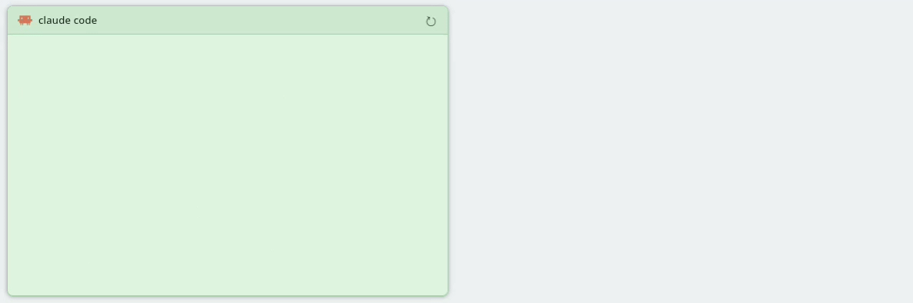

# claude-wait-what

Select a passage in a Claude Code session, press a key, and a second Claude
opens beside it to discuss that passage while the first one goes on with its
work.



## How it works

1. **The hook.** When a Claude Code session starts, a `SessionStart` hook
   records which terminal pane it runs in (Kitty, Konsole, tmux and WezTerm
   expose a pane id in the environment) and the path of its session file.
2. **The trigger.** You select a passage and press the key. The adapter for
   your terminal reads the selection together with the id of the pane it came
   from, and the hook has already recorded which session file belongs to that
   pane.
3. **The source.** The passage is located in the session file. The file holds
   the raw markdown of each message, and the screen shows it rendered, with
   wrapped lines and bullets and without markdown symbols. Both texts are
   reduced to letters and digits before the comparison.
4. **The side instance.** A new Claude Code instance opens next to the first,
   in the same project directory. It receives the passage, the message it
   comes from and the two before it, plus the path of the whole conversation
   exported as plain text, which it opens when the question requires it. Its
   file editing tools are disabled, and its instructions ask it to match the
   length of the answer to the question, so a question about what a term means
   gets a few lines.

If the pane is unknown (a terminal without an adapter, or a session started
before the hook was installed), the passage is searched for in recently
modified sessions.

## Supported terminals

| Terminal  | Trigger | Opens | Tested |
|-----------|---------|-------|--------|
| Kitty     | select, then `Ctrl+A` | a tab in a separate window, with the colors of the source pane | yes |
| Konsole   | select, then a desktop shortcut | a tab in the same window | yes |
| tmux      | `Ctrl+A` in copy mode, or `prefix a` after a mouse selection | a new tmux window | end to end, scripted |
| any other | select, then a desktop shortcut | a window of your default terminal | yes, with Konsole as the default |
| WezTerm   | none yet | adapter not written yet (the hook already records its panes) | no |

In Kitty, `Ctrl+A` moves the cursor to the beginning of the line as usual when
nothing is selected. In tmux the binding exists only in copy mode, and outside
it `Ctrl+A` reaches the program running in the pane.

## Install

Requirements: Linux, Python 3.10+, Claude Code. There are no other
dependencies.

    git clone https://github.com/leonardocppn/claude-wait-what.git

Below, `/path/to/claude-wait-what` is where you cloned it.

**1. The hook.** Add it to `~/.claude/settings.json`.

```json
{
  "hooks": {
    "SessionStart": [
      { "hooks": [ { "type": "command",
          "command": "python3 -I /path/to/claude-wait-what/bin/wait-what hook" } ] }
    ]
  }
}
```

Sessions started before this step still work, because their passage is
searched for among recent sessions.

**2. Trust the working directory, once.** Each side instance gets a folder
under `~/.cache/claude-wait-what/`, and Claude Code asks whether to trust it.
Trusting the parent folder once covers the folders created under it.

    mkdir -p ~/.cache/claude-wait-what && cd ~/.cache/claude-wait-what && claude
    # accept, then /exit

**3. Your terminal.**

*Kitty.* Add this line to `kitty.conf`.

    map ctrl+a kitten /path/to/claude-wait-what/adapters/kitty/wait_what_kitty.py pass-ctrl-a

Side instances open as tabs of a separate window of class `claude-wait-what`;
a window manager rule can place it, for instance on the right half of the
screen.

*Konsole.* Konsole cannot bind a key to a command, and since version 26 it no
longer accepts text sent to its tabs by other programs. It needs a dedicated
profile, created once with the command below. Konsole reads profiles only at
startup, so restart it afterwards.

    /path/to/claude-wait-what/bin/wait-what install-konsole

Konsole also needs the desktop shortcut described under *Any other terminal*.

*tmux.* The command below writes a ready config and prints the `source-file`
line to add to `~/.tmux.conf`.

    /path/to/claude-wait-what/bin/wait-what install-tmux

*Any other terminal.* Bind a desktop shortcut to this command.

    python3 -I /path/to/claude-wait-what/bin/wait-what anywhere

In KDE the shortcut is created in System Settings → Keyboard → Shortcuts →
Add New → Command or Script, in GNOME in Settings → Keyboard → Custom
Shortcuts. Pick a combination with the Super key, since a desktop shortcut
captures its key in every application.

The command reads the primary selection (the text selected last), so it needs
`wl-paste` (package `wl-clipboard`) on Wayland, or `xclip` or `xsel` on X11.
The terminal it opens is the first available of these:

1. the command in `$WAIT_WHAT_TERMINAL`, with the command to run appended;
2. `xdg-terminal-exec`;
3. the first known terminal installed, preferring your desktop's own.

If the source session runs in Konsole and the profile is installed, it opens a
tab there instead.

## What the side instance receives

These are appended to its system prompt:

- the passage;
- the message it comes from and the two before it, each capped at 8,000
  characters (a short question such as "and point 3?" refers to the answer
  before it, so that answer is included too);
- the path of the whole conversation as plain text, with the source message
  marked;
- instructions to wait for the question, size the answer to it, reply in the
  user's language and leave files unchanged.

It starts in the working directory of the source session, so it loads the same
`CLAUDE.md` and memory. It can read project files when a question requires
them, and the `Edit`, `Write` and `NotebookEdit` tools are disabled.

Each side instance has a folder in `~/.cache/claude-wait-what/tangents/`, with
`prompt.md` holding the text it received and `conversation.md` the exported
conversation. Folders older than 7 days are deleted.

## Limitations

- Claude Code's session files are not a public API. claude-wait-what reads a
  few of their fields, and a change in their format can break the search for
  the source message. In that case the side instance opens with the passage
  alone.
- If the same passage appears in two messages, the more recent message is
  used. A passage that spans two messages is matched by its beginning or its
  end.
- With the universal adapter, the primary selection is the text selected last
  in any application, and the session is searched for among those modified in
  the last 12 hours.
- In Konsole the tabs need the profile and one restart, and they do not take
  the colors of the source pane.
- Each side instance is a new session that loads its own system prompt and
  `CLAUDE.md`. When it opens the whole conversation, the length of that file
  adds to the tokens it uses.

## Writing an adapter

An adapter supplies these parts:

1. a trigger that reads the selection;
2. the key of the pane the selection comes from, computed the same way as in
   the hook (`wait_what/registry.py`, `pane_key()`); for a new terminal, add a
   branch there that reads its pane id;
3. a place to open the instance, running `wait-what run FOLDER`.

The core handles the steps between the selection and the opening of the
instance.

    echo "$SELECTION" | wait-what prepare --pane KEY
    # → {"folder": "...", "title": "» ...", "cwd": "...", ...}

Without `--pane`, the session is searched for. If the terminal can open a tab
with a fixed command but cannot pass it an argument, write the folder with
`wait_what.pending.write()` and start `wait-what run --pending` (the Konsole
profile works this way).

Run the tests with `python3 -m unittest discover tests`.

## License

MIT, see [LICENSE](LICENSE).

Unofficial project, not affiliated with or endorsed by Anthropic. Claude and
Claude Code are trademarks of Anthropic.
